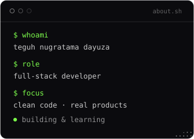

  

---

<h1 align="center">Hi 👋, I'm Teguh Nugratama Dayuza</h1>
<h3 align="center">Full-Stack Developer</h3>
<h3 align="center">Just code. Keep learning.</h3>

  Building reliable web and mobile products with clean architecture and a sharp eye for detail.

---

<h3 align="center">🚀 About Me</h3>

I'm **Teguh Nugratama Dayuza**, a full-stack developer based in **Indonesia**. I build web applications with **CodeIgniter & PHP** and mobile apps with **Kotlin**, and I care about clean architecture, readable code, and interfaces that feel effortless.

I started with **Java** in college, fell in love with **JavaScript** and **C++**, and never really stopped learning. Right now I'm sharpening my **Kotlin** and **TypeScript**, one small project at a time.

Lately I've been building a **school attendance and academic platform** — QR-based check-ins, teaching schedules, and grade books. My goal is simple: **write clean code and build systems that last.**

 

---

<h3 align="center">🤝 Connect</h3>

  
  
  
  

---

<h3 align="center">💻 Tech Stack</h3>

  

---

<h3 align="center">📊 GitHub Stats</h3>

  

---

<h3 align="center">📈 Activity Graph</h3>

  

