  

<h1 align="center">Hi 👋, I'm Teguh Nugratama Dayuza</h1>

<h3 align="center">Full-Stack Developer</h3>

  

  Building reliable web and mobile products with clean architecture and a sharp eye for detail.

<h2 align="center">🚀 About Me</h2>

**Dayuza** — a full-stack developer from Indonesia who cares about clean architecture, readable code, and interfaces that feel effortless.

I build web applications with **CodeIgniter & PHP** and mobile apps with **Kotlin**, usually shipping end-to-end: database, API, and UI.

I started with **Java** in college, fell in love with **JavaScript** and **C++**, and never really stopped learning.

Lately I've been building a **school attendance and academic platform** — QR-based check-ins, teaching schedules, and grade books — while sharpening my **Kotlin** and **TypeScript**.

My goal is simple: write clean code, build reliable software, and grow into a developer who creates systems that last.

 

<h2 align="center">🤝 Connect</h2>

  
  &nbsp;&nbsp;&nbsp;
  
  &nbsp;&nbsp;&nbsp;
  
  &nbsp;&nbsp;&nbsp;
  

<h2 align="center">💻 Tech Stack</h2>

  

  
  &nbsp;&nbsp;
  
  &nbsp;&nbsp;
  
  &nbsp;&nbsp;
  
  &nbsp;&nbsp;
  
  &nbsp;&nbsp;
  
  &nbsp;&nbsp;
  

<h2 align="center">📊 GitHub Stats</h2>

<h2 align="center">📈 Activity Graph</h2>

  

<h2 align="center">⌘ Commit Activity</h2>

  <picture>
    <source media="(prefers-color-scheme: dark)" srcset="https://raw.githubusercontent.com/dayuza/dayuza/output/pacman-contribution-graph-dark.svg">
    <source media="(prefers-color-scheme: light)" srcset="https://raw.githubusercontent.com/dayuza/dayuza/output/pacman-contribution-graph.svg">
    
  </picture>

<h2 align="center">⌘ Philosophy</h2>

  

